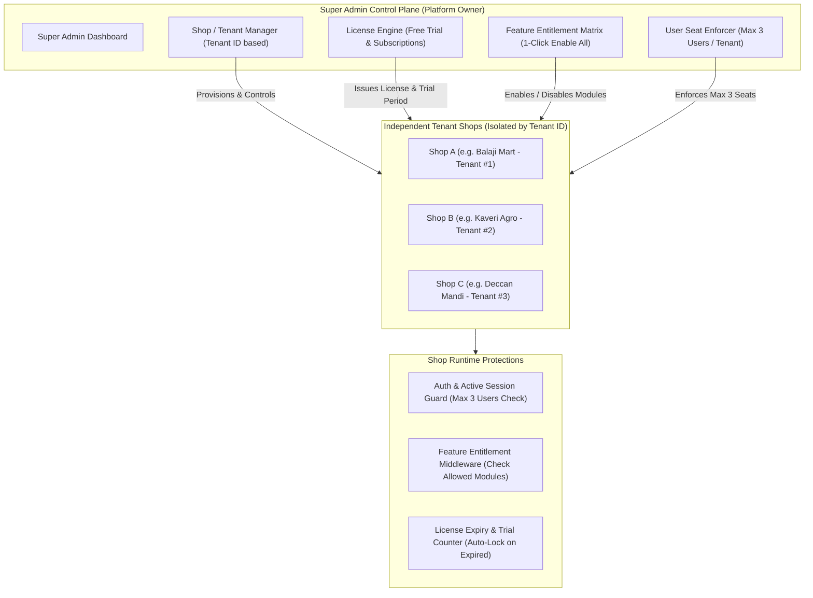

# Super Admin Multi-Tenant Governance, Licensing & Feature Control Plan
**Module**: Super Admin Control Plane (`/super-admin/dashboard`)  
**Backend API**: Express + Prisma ORM + MySQL (`backend/src/modules/super-admin/`)  
**Web App**: Next.js 15 + TypeScript + Tailwind CSS (`web/src/app/super-admin/`)  
**Target Architecture**: Multi-Tenant Shop Isolation (`tenantId`), Free Trial & Paid Licensing, 1-Click Feature Toggles, Strict Max 3 Users per Shop.

---

## 1. Executive Architecture Overview



---

## 2. Core Business Requirements & Rules

### A. Multi-Tenant Shop Isolation (`tenantId`)
- Every physical shop or store operates under an immutable UUID `tenantId`.
- Complete data isolation:
  - Inventory, arrival lots, bills, ledgers, suppliers, customers, and daily cash drawer tallies are strictly filtered by `where: { tenantId }`.
  - No shop can view, search, or access another shop's data.

### B. Free Trial & Subscription Licensing
1. **Free Trial Provisions**:
   - Every newly created shop receives an automatic **Free Trial** (configurable: 14 days or 30 days).
   - `SubscriptionStatus`: `TRIAL` → `ACTIVE` → `EXPIRED` → `SUSPENDED`.
   - In-app countdown banner: *"Free Trial: X days remaining"*.
2. **Shop License Key**:
   - Cryptographic License Key generated per shop: e.g. `BSG-LIC-2026-X8K9-M4P2`.
   - Super Admin can generate a printable **Shop License Certificate** with QR code and activation details.
3. **Automated Expiry & Renewal**:
   - Super Admin can extend trial by (+7, +14, +30 days) or upgrade to an **Annual Paid License** with 1 click.
   - If a trial or subscription expires, the shop's write actions are blocked with a clear screen:  
     *"Your Shop License has Expired. Please contact Platform Administrator to renew."*

### C. Feature Entitlement Control (1-Click "Enable All Features")
Super Admin controls which modules are unlocked for each shop:
- [x] **Multi-Product Inward Arrival Lots** (Lorries carrying multiple crops under one lot)
- [x] **Multi-Product Cash & Credit Billing** (Adding multiple products to one bill)
- [x] **Mandi Bag Weighment Calculator & Scale Table** (Individual bag weights 52, 53, 53, 54, 38 kg)
- [x] **Daily Tally & Cash Drawer Reconciliation** (Denomination counter & variance audit)
- [x] **Smart Chart Live Auctioning** (Arrival lot bidding and instant settlement)
- [x] **Customer & Supplier Ledgers** (Real-time running balances, PDF statements, advance adjustments)
- [x] **6 Financial & Tax Reports** (Sales drilldown by Buyer/Crop/Product/Date, P&L, Inventory, RMC Cess)
- [x] **WhatsApp Invoice Generator** (Direct receipt text sharing)
- [x] **Multi-Device Mobile App Sync** (Flutter Android offline-first app)
- **1-Click Master Action**: **`Enable All Features for this Shop`** button.

### D. Strict Seat Limit: Maximum 3 Users Login per Tenant ID
1. **Account Creation Enforcer**:
   - A single shop can have at most **3 active user accounts** (e.g. 1 Store Owner / Admin + 2 Billing Clerks / Staff).
   - In the shop's Admin user management screen:
     - Active user count badge: `Users: 2 / 3 Seats Occupied`.
     - When count reaches 3, the `+ Add New User` button is disabled with message:  
       *"Seat limit reached (3/3). Your shop license permits a maximum of 3 users."*
2. **Login Concurrency & Session Enforcer**:
   - Backend `auth.routes.ts` checks active authenticated sessions for the `tenantId`.
   - If 3 distinct users are currently active and a 4th tries to log in, authentication is rejected with `403 SEAT_LIMIT_EXCEEDED`:  
     *"Maximum 3 active user sessions allowed for your shop. Please log out from another device or contact Super Admin."*
3. **Super Admin Session Management**:
   - Super Admin can view all 3 active users for any shop and revoke any session remotely.

---

## 3. Database Schema Updates (`schema.prisma`)

```prisma
model Tenant {
  id                   String                 @id @default(uuid())
  code                 String                 @unique // e.g. "SH-101"
  name                 String                        // e.g. "Balaji Vegetable Mart"
  slug                 String                 @unique // e.g. "balaji-mart"
  status               TenantStatus           @default(TRIAL)
  licenseKey           String                 @unique @default(cuid())
  maxUsers             Int                    @default(3) // Strictly 3 users allowed
  trialEndsAt          DateTime?
  subscriptionEndsAt   DateTime?
  enabledFeatures      Json?                  // Array of feature keys enabled for this shop
  ownerName            String
  ownerPhone           String
  ownerEmail           String
  city                 String?
  marketLocation       String?
  createdAt            DateTime               @default(now())
  updatedAt            DateTime               @updatedAt
  ...
}

model ActiveUserSession {
  id          String   @id @default(uuid())
  tenantId    String
  userId      String
  deviceInfo  String?
  ipAddress   String?
  lastActiveAt DateTime @default(now())
  createdAt   DateTime @default(now())

  tenant      Tenant   @relation(fields: [tenantId], references: [id], onDelete: Cascade)
  user        User     @relation(fields: [userId], references: [id], onDelete: Cascade)

  @@unique([tenantId, userId])
  @@index([tenantId])
}
```

---

## 4. Super Admin Web Portal Implementation (`web/src/app/super-admin/`)

### Tab 1: "Shops & Stores Management" (`ShopsTab.tsx`)
- **Key Metrics**:
  - Total Registered Shops
  - Active Trialing Shops (with average days left)
  - Active Paid Subscriptions
  - Expired / Pending Renewal Shops
  - Total Active Users Across All Shops
- **Shops Master Table**:
  - Columns:
    - **Shop Name & Code**: e.g. *Balaji Mart (`SH-101`)*
    - **Owner & Phone**: e.g. *Ramesh Kumar (98401 98765)*
    - **License Key**: Masked with 1-click copy: `BSG-LIC-****-M4P2`
    - **License Status**: `TRIAL` (Green chip), `ACTIVE` (Blue chip), `EXPIRED` (Red chip)
    - **Days Left**: e.g. *12 days left* (or *Expired 2 days ago*)
    - **User Seats**: Badge showing `1/3`, `2/3`, or `3/3` occupied
    - **Features Enabled**: e.g. *All 10 Features Enabled*
    - **Actions**:
      - `⚙️ Manage License & Features`
      - `⏱️ Extend Trial / Renew`
      - `🔒 Suspend / Activate`
      - `📄 Print License Certificate`

### Modal 1: "Create New Shop / Tenant" (`CreateShopModal.tsx`)
- Form inputs:
  - Shop / Business Name (e.g. *Sri Murugan Tomato Agency*)
  - Market / Mandi Location (e.g. *Madurai Central Vegetable Market*)
  - Owner Full Name & Mobile Number
  - Store Admin Login Username & Temporary Password
  - Trial Period Duration (Default: 14 Days, 30 Days, or Custom)
  - User Seat Limit (Default: **3 Users**)
  - Pre-selected Feature Set (Checkbox: **[x] Enable All Features**)
- Output on submit:
  - Generates `tenantId`, registers primary Admin, generates License Key, and opens **Download / Print License Certificate**.

### Modal 2: "Shop License & Feature Entitlement Manager" (`ShopLicenseModal.tsx`)
- **License Details**:
  - License Key, Current Status, Valid From, Valid Until.
  - Buttons:
    - `+15 Days Trial Extension`
    - `+30 Days Extension`
    - `Upgrade to 1-Year Paid License`
    - `Revoke / Suspend License`
- **Feature Toggles Matrix**:
  - Big CTA: **`🚀 Enable All Features (Full Mandi Suite)`**
  - Granular toggles:
    - [x] Multi-Product Inward Arrivals
    - [x] Multi-Product Billing & Weighment Calculator
    - [x] Daily Cash Tally & Denomination Counter
    - [x] Smart Chart Live Auctioning
    - [x] Customer & Supplier Ledgers
    - [x] Financial & Tax Reports
    - [x] WhatsApp Receipt Sharing
    - [x] Mobile App Access
- **Active User Seats (Max 3)**:
  - Displays the 3 user slots with usernames, roles, and last login timestamps.
  - Button to **Kick / Revoke Session** or reset password.

### Modal 3: "Printable License Certificate" (`LicenseCertificateModal.tsx`)
- Professional branded certificate for the shop owner:
  - BSG Platform Header & Seal
  - Shop Name & Mandi Location
  - Licensed Owner Name & Contact Number
  - Unique License Key & QR Code for scanning
  - Valid Period & Expiry Date
  - Quota: **3 Authorized User Seats**
  - Print / Export PDF button.

---

## 5. Backend Enforcement Implementation (`backend/`)

### A. License & Expiry Middleware (`requireActiveLicense.ts`)
```typescript
export async function requireActiveLicense(req: Request, res: Response, next: NextFunction) {
  const tenantId = req.user?.tenantId;
  if (!tenantId) return next();

  const tenant = await prisma.tenant.findUnique({
    where: { id: tenantId },
    select: { status: true, trialEndsAt: true, subscriptionEndsAt: true, enabledFeatures: true, maxUsers: true }
  });

  const now = new Date();
  const isTrialExpired = tenant?.status === "TRIAL" && tenant.trialEndsAt && tenant.trialEndsAt < now;
  const isSubExpired = tenant?.status === "ACTIVE" && tenant.subscriptionEndsAt && tenant.subscriptionEndsAt < now;

  if (tenant?.status === "SUSPENDED") {
    throw new AppError(403, "TENANT_SUSPENDED", "Your shop access has been suspended by Platform Admin.");
  }

  if (isTrialExpired || isSubExpired || tenant?.status === "EXPIRED") {
    // Read-only allowed or full lock on write operations (POST, PUT, PATCH, DELETE)
    if (["POST", "PUT", "PATCH", "DELETE"].includes(req.method)) {
      throw new AppError(402, "SUBSCRIPTION_EXPIRED", "Your shop license or free trial has expired. Please contact Admin to renew.");
    }
  }

  req.tenantConfig = tenant;
  next();
}
```

### B. Seat Limit Enforcement on User Creation (`user.service.ts`)
```typescript
export async function enforceUserSeatLimit(tenantId: string) {
  const tenant = await prisma.tenant.findUnique({
    where: { id: tenantId },
    select: { maxUsers: true }
  });
  const maxAllowed = tenant?.maxUsers ?? 3; // Default 3 users max

  const currentCount = await prisma.user.count({
    where: { tenantId, deletedAt: null }
  });

  if (currentCount >= maxAllowed) {
    throw new AppError(
      403,
      "SEAT_LIMIT_REACHED",
      `Your shop license allows a maximum of ${maxAllowed} users (${currentCount}/${maxAllowed} seats occupied). Please contact Platform Admin to upgrade your license.`
    );
  }
}
```

### C. Feature Entitlement Guard (`requireFeature.ts`)
```typescript
export function requireFeature(featureKey: string) {
  return (req: Request, res: Response, next: NextFunction) => {
    const features = (req.tenantConfig?.enabledFeatures as string[]) || [];
    if (!features.includes(featureKey) && !features.includes("ALL")) {
      throw new AppError(
        403,
        "FEATURE_NOT_LICENSED",
        `The module '${featureKey}' is not enabled for your shop license. Contact Admin to activate.`
      );
    }
    next();
  };
}
```

---

## 6. Execution Milestones

| Milestone | Deliverables | Verification Gates |
| :--- | :--- | :--- |
| **Milestone 1** | Database schema & License model | Migration applied, `maxUsers = 3`, `licenseKey`, `enabledFeatures` added |
| **Milestone 2** | Backend Super Admin API endpoints | CRUD shops, generate license keys, trial extension, feature toggling |
| **Milestone 3** | Seat limit & Expiry middlewares | Blocks 4th user creation, blocks write actions after trial expiration |
| **Milestone 4** | Super Admin UI: Shops Management Tab | Interactive shops table with status badges, trial countdowns, seat indicators |
| **Milestone 5** | Super Admin UI: Feature Matrix & Renewal Modal | 1-click "Enable All Features" toggle, trial extensions, license slip print |
| **Milestone 6** | End-to-end multi-tenant validation | Verified with 3 distinct shop tenants, trial countdown, and max-3 user limits |
