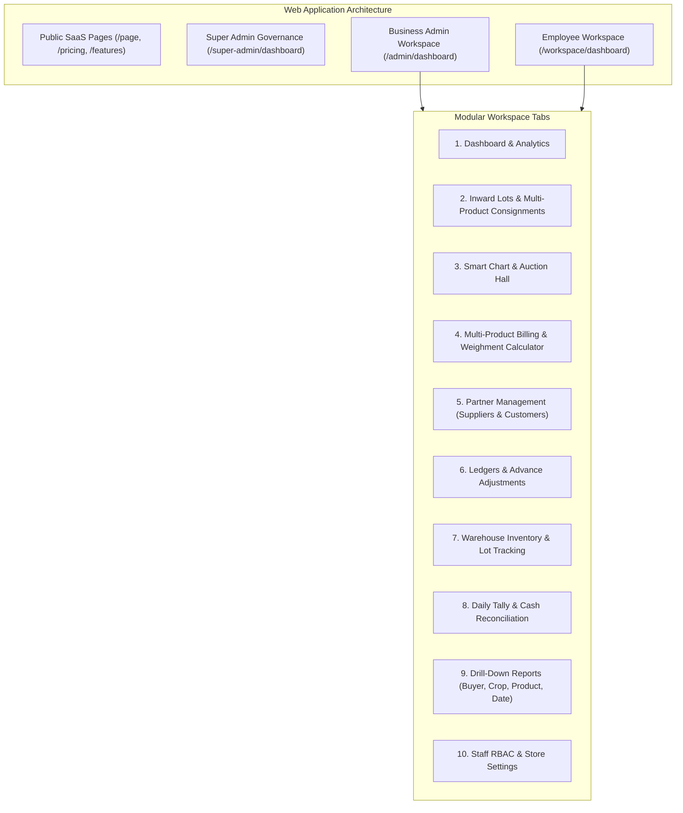

# BSG Web Application — Full Implementation Plan
**Platform**: Next.js 15 (App Router) + TypeScript + Tailwind CSS + Lucide Icons + TanStack Query + Zustand  
**Target Path**: `s:\Project\BuyerSellerManagementAPPSaas\web`

---

## Executive Overview
The BSG Web Application provides business administrators, accounting staff, and super administrators with a complete cloud-native platform for agricultural commodity trading, Mandi lot arrivals, multi-product invoicing, partner ledgers, and financial analytics.

This implementation plan bridges all business logic and user experience breakthroughs built in the Flutter mobile app into the Next.js web application, while modularizing the existing 2,372-line monolithic workspace into an enterprise-grade component architecture.



---

## Phase 1: Architectural Modularization & Terminology Refactor

### Objectives:
- Refactor the monolithic `BusinessWorkspace.tsx` (2,372 lines) into a clean, modular structure.
- Enforce the mandatory business terminology across all web pages, tables, forms, and exports:
  - **Seller → Supplier**
  - **Buyer → Customer**
  - **Seller Ledger → Supplier Ledger**
  - **Buyer Ledger → Customer Ledger**

### New Directory Structure (`web/src/features/workspace/`):
```
web/src/features/workspace/
├── WorkspaceShell.tsx            # Navigation sidebar, topbar, global search, tenant badge
├── tabs/
│   ├── DashboardTab.tsx          # Key metrics, sales vs purchase charts, recent transactions
│   ├── GoodsLotsTab.tsx          # Multi-product arrival lots, status filters, consignment entry
│   ├── SmartChartTab.tsx         # Arrival lot auctioning, lot-to-bill conversion
│   ├── BillsTab.tsx              # Cash bills, credit bills, paper invoice print modal
│   ├── PartnersTab.tsx           # Supplier & Customer directory with balance badges
│   ├── LedgersTab.tsx            # Running balance statements, payments & advances
│   ├── InventoryTab.tsx          # Stock movement, lot stock levels, wastage adjustments
│   ├── DailyTallyTab.tsx         # Cash drawer reconciliation & denomination counter
│   ├── ReportsTab.tsx            # Drill-down reports (Buyer, Crop, Product, Date, P&L)
│   ├── UsersTab.tsx              # Employee management & granular permissions (Admin only)
│   └── SettingsTab.tsx           # Business profile, print receipt layout, market fee rules
├── modals/
│   ├── CreateLotModal.tsx        # Multi-product inward arrival wizard
│   ├── CreateBillModal.tsx       # Multi-product billing wizard with bag calculator
│   ├── BagWeighmentModal.tsx     # Interactive bag-by-bag weights table modal
│   ├── BillPrintModal.tsx        # Thermal (80mm) slip & A4 GST/Mandi voucher preview
│   ├── RecordPaymentModal.tsx    # Cash, UPI/GPay, Bank transfer, Cheque collection
│   ├── DailyTallyModal.tsx       # Closing physical cash tally form
│   └── PartnerFormModal.tsx      # Add/edit Supplier or Customer
└── components/
    ├── WeighmentTable.tsx        # Mandi paper slip weighment grid
    ├── MetricCard.tsx            # KPI metric cards with trends
    ├── DataTable.tsx             # Paginated, sortable, exportable table with search
    └── SearchFilterBar.tsx       # Date range, crop filter, search bar
```

---

## Phase 2: Inward Lot Management & Multi-Product Consignments

### Core Capabilities:
1. **Multi-Product Inward Consignments**:
   - Allow trucks/lorries carrying multiple commodities (e.g. *Hybrid Tomatoes + Country Tomatoes + Muskmelon*) to be recorded under one arrival consignment or split into linked lots.
   - Dynamic commodity selector with visual crop categories (*Vegetables, Fruits, Flowers, Field Crops, Spices*) and thumbnail badges.
2. **Consignment Cost Breakdown**:
   - Supplier selection with live balance and contact number.
   - Vehicle number, driver phone, gate entry slip number.
   - Farm gate cost rate per unit/bag.
   - Mandi unloading, freight/transport charges, hamali charges.
3. **Consignment Status Lifecycle**:
   - `ACTIVE` → `PARTIALLY_SOLD` → `FULLY_SOLD` → `CANCELLED`.
   - Real-time stock balance updating as lots are sold through bills.

---

## Phase 3: Multi-Product Billing & Weighment Calculator

### Core Capabilities:
1. **Multi-Product Line Items**:
   - Support adding multiple commodities/lots to a single Cash Bill or Credit Bill.
   - Dynamic product rows:
     - **Product / Lot**: Dropdown with remaining quantity and stock badge.
     - **Bag Quantity**: Direct bag count input.
     - **Weight (Kg)**: Direct weight or automated sum from individual bags.
     - **Weights Scale Button**: Opens the **Bag Weighment Modal**.
     - **Selling Rate (₹/Kg or ₹/Bag)**.
     - **Gross Amount**: Automatic line item total.
     - **`+ Add More Products to this Bill`** button.
2. **Mandi Bag Weighment Calculator Modal**:
   - Grid layout to enter individual weights for every single bag (e.g., Bag #1: 52kg, #2: 53kg, #3: 53kg, #4: 54kg, #5: 38kg).
   - Auto-sums `Total Bags` and `Total Net Weight`.
   - Populates back into the main invoice line item.
3. **Mandi Additional Charges & Settlement**:
   - Hamali / Labour charge (+₹).
   - Weighment charges (+₹).
   - Transport / Delivery fee (+₹).
   - Market Committee Cess (RMC 1% checkbox toggle).
   - Discount (-₹).
4. **Payment Collection Methods**:
   - Hand Cash, GPay / UPI / PhonePe, Bank Transfer (IMPS/NEFT), Cheque.
   - Transaction Reference / UTR Number field for non-cash methods.
   - Notes / Delivery vehicle remarks field.
5. **Invoice Output & Printing**:
   - **Mandi Goods & Weighment Table**: S.No, Lot Num, Commodity, Bags, Each Bag Weight breakdown, Total Weight, Rate, Subtotal.
   - **Thermal Receipt (80mm)**: Optimized for Bluetooth/USB POS receipt printers.
   - **A4 Corporate Bill**: Branded PDF format with business header, customer details, and tax summary.
   - **WhatsApp Invoice Generator**: Pre-formatted text summary with quick share button.

---

## Phase 4: Daily Tally & Cash Drawer Reconciliation

### Core Capabilities:
1. **End-of-Day Cash Balancing**:
   - **Opening Cash in Hand**: Brought forward from previous day's close.
   - **Cash Inflows**: Counter Cash Bills + Customer Cash Receipts.
   - **Cash Outflows**: Supplier Cash Payouts + Hamali/Labour Expenses + Transport/Store Expenses.
   - **Expected System Cash**: `Opening Cash + Inflows - Outflows`.
2. **Physical Cash Denomination Calculator**:
   - Counter inputs for ₹2000, ₹500, ₹200, ₹100, ₹50, ₹20, ₹10, ₹5, ₹2, ₹1, and Coins.
   - Real-time sum of physical cash.
   - **Cash Variance**: `Physical Cash - Expected Cash` (Surplus / Shortage indicator).
   - Audit note field for explaining shortages or surpluses.
   - Historical Daily Tally log with export to CSV and print.

---

## Phase 5: Drill-Down Analytics & Financial Reports

### Core Reports Suite:
1. **Sales Report (Interactive Drill-Downs)**:
   - **By Customer / Buyer**: Sales volume, total billed amount, collections received, outstanding due.
   - **By Crop / Category**: Tonnes sold, total revenue, average realization rate per kg/bag.
   - **By Product Grade**: Grade-A vs Grade-B yield and revenue.
   - **By Date / Period**: Daily, weekly, monthly sales velocity and payment mode breakdown.
2. **Purchase & Inward Procurement Report**:
   - Supplier-wise arrival volume, crop weight, procurement amount, payment settlements.
3. **Gross Profit & Margin Analysis**:
   - Invoice-by-invoice reconciliation: `Selling Price - Farm Gate Purchase Rate - Direct Expenses = Gross Margin`.
   - Margin percentage calculation with profit health indicators.
4. **Stock Movement & Warehouse Inventory**:
   - Opening Stock + Inward Arrivals - Billed Sales - Wastage/Damage = Closing Balance.
5. **RMC / Market Cess Report**:
   - Mandi committee tax audit register for regulatory compliance.

---

## Phase 6: Public SaaS Marketing Pages & UX Polish

### Enhancements:
1. **Design System & Typography**:
   - Standardize Tailwind typography with Inter / clean sans-serif.
   - Consistent slate/emerald/amber color accents matching the corporate mobile app.
2. **Responsive Table & Mobile Layout**:
   - Horizontal scrolling wrappers with sticky column headers for high-density tables.
   - Mobile sheet drawers for forms and filters when accessed on tablet/browser.
3. **Public Landing, Pricing, and Register Pages**:
   - Highlight multi-tenant architecture, multi-product lot arrival, Mandi weighment calculator, and mobile app sync.
   - Tiered pricing plans (Starter, Professional, Enterprise) with instant tenant registration.

---

## Phase 7: Verification, Automated Testing & Deployment

### Testing Gates:
1. **Type Checking**:
   - Run `tsc --noEmit` across all modules to ensure 100% strict TypeScript compliance.
2. **Vitest Unit & Component Tests**:
   - Test billing calculation engine (gross amount, charges, discounts, balance due).
   - Test bag weighment modal sum and validation logic.
   - Test daily tally cash variance calculations.
   - Test customer/supplier ledger running balance math.
3. **Production Build**:
   - Run `npm run build` to verify Next.js static and dynamic route generation.

---

## Execution Milestones

| Milestone | Deliverables | Verification Criteria |
| :--- | :--- | :--- |
| **Milestone 1** | Workspace modularization & terminology refactor | Clean folder structure, 0 TypeScript errors |
| **Milestone 2** | Multi-product inward arrival lots & crop catalogue | Can create lots with 2+ commodities and visual icons |
| **Milestone 3** | Multi-product billing & bag weighment modal | Full invoice flow with bag-by-bag weights & thermal print |
| **Milestone 4** | Daily Tally cash reconciliation | Denomination counter with live variance calculation |
| **Milestone 5** | Drill-down reports (Buyer, Crop, Product, Date) | Interactive filtering, data tables, CSV exports |
| **Milestone 6** | Vitest test suite & Next.js production build | `npm test` passing, `npm run build` succeeds |
